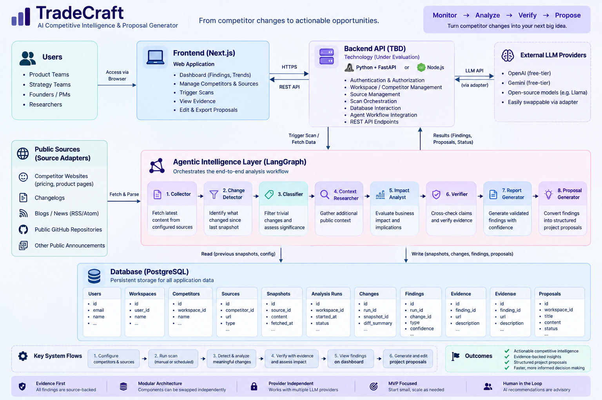

# TradeCraft System Architecture



## 1. Architecture Overview

TradeCraft is a full-stack application that monitors public competitor sources, detects meaningful changes, investigates supporting context, evaluates potential impact, verifies evidence, and generates actionable competitive intelligence and project proposals.

The MVP follows a modular architecture so that individual technologies can be changed without redesigning the complete system.

## 2. High-Level Architecture

The system consists of six major layers:

1. Frontend Layer
2. Backend API Layer
3. Agentic Intelligence Layer
4. Source Adapter Layer
5. Database Layer
6. LLM Layer

## 3. Backend Technology Decision

The backend technology is finalized as **Python + FastAPI**.

### Key Rationale

- Native compatibility with Python AI/ML and agent ecosystems (LangGraph, NumPy, Difflib, BeautifulSoup4, Feedparser).
- High-performance asynchronous request handling with Starlette/Uvicorn.
- Automatic OpenAPI/Swagger documentation generation.
- Strong type validation via Pydantic v2.
- Clean database integration with SQLAlchemy 2.0 ORM and Alembic migrations.

## 4. Frontend Layer

The frontend provides the user-facing responsive web application.

### Responsibilities

- Authentication and multi-tenant workspace context
- Competitor management and public source configuration
- Concurrent scan controls and live execution indicators
- Detected changes intelligence feed with meaningfulness filters
- Interactive line-by-line unified diff viewer (`DiffViewer.jsx`)
- Historical snapshot inspector (`SnapshotHistoryModal.jsx`)
- Real-time dark/light color mode toggle and notification center

### Technology

```text
React 19 + Vite
Pure Utility CSS (design tokens & variables)
Lucide React icons
```

## 5. Backend API Layer

The backend acts as the core application engine connecting the React frontend, PostgreSQL database, source adapters, and diffing engine.

### Responsibilities

- Multi-tenant JWT authentication and ownership enforcement
- Request validation and serialization with Pydantic schemas
- Workspace, competitor, and source CRUD management
- Asynchronous scan orchestration with bounded concurrency
- Source content normalization and deterministic SHA-256 hashing
- Line-by-line unified diff generation and meaningfulness classification
- REST API endpoints for scans, snapshots, and detected changes

### Technology Stack

```text
FastAPI + Python 3.13
SQLAlchemy 2.0 ORM + Alembic
PostgreSQL (production) / SQLite (offline fallback & testing)
HTTPX + BeautifulSoup4 + Feedparser (Adapters)
Difflib (Diff Engine)
```

## 6. Agentic Intelligence Layer

The agentic intelligence layer transforms raw competitor changes into validated competitive intelligence.

### Planned Orchestration

```text
LangGraph
```

### Workflow

```text
START
  ↓
Collector
  ↓
Change Detector
  ↓
Change Classifier
  │
  ├── No meaningful change → END
  │
  ↓
Context Researcher
  ↓
Impact Analyst
  ↓
Critic / Verifier
  │
  ├── Rejected / insufficient evidence → END
  │
  ↓
Report Generator
  ↓
Optional Proposal Generator
  ↓
END
```

### Agent Responsibilities

| Agent | Responsibility |
|---|---|
| Collector | Fetch configured public sources and latest snapshots |
| Change Detector | Determine what changed since the previous snapshot |
| Change Classifier | Filter trivial changes and classify significance |
| Context Researcher | Gather additional supporting context |
| Impact Analyst | Relate the change to the user's product/project context |
| Critic / Verifier | Challenge unsupported claims and assess evidence |
| Report Generator | Produce facts, interpretation, evidence, confidence, and recommendation |
| Proposal Generator | Convert validated findings into a structured project proposal |

## 7. Source Adapter Layer

Source adapters retrieve and normalize public competitor information.

### Planned Sources

- Competitor pricing pages
- Competitor product pages
- Changelogs
- Blogs / RSS / Atom feeds
- Public GitHub repositories
- Other public announcements where applicable

### Source Processing

```text
Public Source
     ↓
HTTP Fetch
     ↓
Parser / Content Extraction
     ↓
Normalized Source Data
     ↓
Snapshot Storage
     ↓
Change Detection
```

The MVP should prefer simple HTTP fetching and parser-based extraction where practical. Complex browser automation should only be introduced when a selected source requires JavaScript rendering.

## 8. Database Layer

PostgreSQL is planned as the primary application database.

The database stores application state, source snapshots, analysis results, evidence, and generated proposals.

### Main Entities

```text
Users
  │
  ▼
Workspaces
  │
  ├── Competitors
  │      └── Sources
  │             └── Snapshots
  │
  └── Analysis Runs
          ├── Changes
          └── Findings
                 └── Evidence

Workspaces
    │
    └── Proposals
```

### Planned Tables

| Table | Purpose |
|---|---|
| users | User accounts |
| workspaces | Product/project context |
| competitors | Competitor profiles |
| sources | Configured public URLs |
| snapshots | Previously fetched source content |
| analysis_runs | Individual scan executions |
| changes | Detected source changes |
| findings | Validated competitive intelligence |
| evidence | Source-backed supporting evidence |
| proposals | Generated project proposals |

## 9. Data Flow

The main system flow is:

```text
User
  ↓
Next.js Frontend
  ↓
Backend API
  ↓
Start Scan
  ↓
Source Adapters
  ↓
Fetch Current Sources
  ↓
Store / Compare Snapshots
  ↓
Detect Changes
  ↓
LangGraph Workflow
  ↓
Classify
  ↓
Research
  ↓
Impact Analysis
  ↓
Verification
  ↓
Validated Finding
  ↓
Dashboard
  ↓
Optional Proposal Generation
```

## 10. Evidence Flow

Every intelligence finding must maintain a connection to its supporting source evidence.

```text
Public Source
      ↓
Source Snapshot
      ↓
Detected Change
      ↓
Candidate Finding
      ↓
Supporting Evidence
      ↓
Verification
      ↓
Validated Finding
```

The system clearly separates:

### FACTS

Information directly observed from collected source evidence.

### INTERPRETATION

AI-generated analysis of what the observed change may mean.

### RECOMMENDATION

A suggested next step based on the evidence and interpretation.

AI-generated interpretation and recommendations should never be presented as observed competitor facts.

## 11. LLM Layer

The LLM layer provides language-model capabilities to the agentic workflow.

The application should not depend on a single paid AI provider.

### Architecture

```text
Agent Workflow
      ↓
LLM Adapter
      ↓
Configurable Provider / Model
```

The provider and model should be configurable through environment variables.

The architecture should support:

- Free-tier providers
- Open-source models
- Replaceable model providers
- Graceful handling of model failures and rate limits

The exact provider and model will be finalized during implementation.

## 12. API Boundary

The frontend communicates with the backend through a stable REST API boundary enforcing JWT multi-tenant isolation.

### Implemented REST Endpoints

```text
# Authentication
POST   /auth/register
POST   /auth/login
GET    /auth/me

# Workspaces
POST   /workspaces
GET    /workspaces
GET    /workspaces/{id}
PUT    /workspaces/{id}
DELETE /workspaces/{id}

# Competitors
POST   /workspaces/{ws_id}/competitors
GET    /workspaces/{ws_id}/competitors
GET    /workspaces/{ws_id}/competitors/{id}
PUT    /workspaces/{ws_id}/competitors/{id}
DELETE /workspaces/{ws_id}/competitors/{id}

# Sources
POST   /competitors/{c_id}/sources
GET    /competitors/{c_id}/sources
GET    /competitors/{c_id}/sources/{id}
PUT    /competitors/{c_id}/sources/{id}
DELETE /competitors/{c_id}/sources/{id}

# Scans & Snapshots (Phase 3)
POST   /workspaces/{id}/scan
POST   /competitors/{id}/scan
GET    /workspaces/{id}/scans
GET    /scans/{id}
GET    /sources/{id}/snapshots

# Detected Changes & Diffing (Phase 4)
GET    /workspaces/{id}/changes
GET    /changes/{id}
GET    /scans/{id}/changes

# System Health
GET    /health
```

## 13. Primary User Workflow

```text
1. Configure workspace
        ↓
2. Add competitors
        ↓
3. Configure public sources (HTML / RSS)
        ↓
4. Run scan (on-demand concurrent collection)
        ↓
5. Fetch and snapshot sources (deterministic SHA-256 hash)
        ↓
6. Detect changes (line-by-line unified diff calculation)
        ↓
7. Classify meaningful changes (noise filter vs substantive shift)
        ↓
8. Research supporting context (Phase 5)
        ↓
9. Analyze likely impact (Phase 5)
        ↓
10. Verify evidence (Phase 6)
        ↓
11. Display validated findings
        ↓
12. Select finding
        ↓
13. Generate project proposal (Phase 7)
        ↓
14. Edit proposal
        ↓
15. Export / copy proposal
```

## 14. Design Principles

### Modularity

Each major component should have a clear responsibility and interface so that technologies can be replaced independently.

### Evidence First

Competitive-intelligence findings must be grounded in source-backed evidence.

### Human in the Loop

AI recommendations are advisory. The system should not perform external business actions without user approval.

### Provider Independence

LLM providers should be replaceable through configuration rather than being hard-coded into business logic.

### Deterministic First

Deterministic processing such as source comparison, hashing, and trivial-change filtering should happen before unnecessary LLM calls.

### Minimal Infrastructure

The MVP avoids unnecessary infrastructure such as microservices, Kubernetes, or distributed task queues unless a concrete requirement emerges.

### Reproducibility

Source URLs, timestamps, snapshots, run information, and evidence are retained so that findings can be traced back to their exact origin.

## 15. Current Technology Decisions

| Component | Current Status |
|---|---|
| Frontend | **React 19 + Vite (JavaScript)** — Responsive dashboard, diff inspector, and dark/light UI |
| Backend API | **FastAPI + Python 3.13** — Async REST endpoints, Pydantic v2 schemas |
| Database | **PostgreSQL + SQLAlchemy 2.0 ORM** (with SQLite offline/test fallback) |
| Database Migrations | **Alembic** (`5110aac07da3`, `7a8b9c0d1e2f`, `8c9d0e1f2a3b`) |
| Security & Auth | **JWT (pyjwt) + bcrypt password hashing** with HTTPBearer dependency |
| Ingestion Adapters | **Async HTTPX, BeautifulSoup4, Feedparser** with boilerplate suppression |
| Diff Engine | **Difflib + SHA-256 hashing** for line-by-line unified diffs and stats |
| Meaningfulness Classifier | **Heuristic rule engine** filtering noise and classifying substantive categories |
| Agent Orchestration | **LangGraph** (Phase 5) |
| LLM Provider | **Provider-independent adapter** (Free/Open-source/Free-tier) |

## 16. Architecture Status

**Status: Phase 4 — Deterministic Change Detection & Classification Complete**

---

## 17. Implementation Status Matrix

### Implemented Components

| Component | Status | Notes |
|---|---|---|
| Backend Architecture | ✅ Done | FastAPI + Python + SQLAlchemy ORM |
| Authentication | ✅ Done | JWT access tokens + bcrypt hashing (`/auth/register`, `/auth/login`, `/auth/me`) |
| Entity Relationships | ✅ Done | `User` ➔ `Workspace` ➔ `Competitor` ➔ `Source` ➔ `Snapshot` / `Change` |
| Database Migrations | ✅ Done | Alembic migrations for initial schema, scans/snapshots, and changes |
| Core REST APIs | ✅ Done | CRUD endpoints for Workspaces, Competitors & Sources with multi-tenant isolation |
| Source Adapters | ✅ Done | Async HTML & RSS ingestion with boilerplate suppression & timeout guards |
| Snapshot Storage Engine | ✅ Done | Immutable snapshot history, deterministic SHA-256 content hashing |
| Scan Orchestration | ✅ Done | Concurrent bounded scans across active sources with partial failure resilience |
| Change Detection & Diffing | ✅ Done | Line-by-line unified diffs, diff statistics, deterministic change hashing |
| Meaningfulness Classifier | ✅ Done | Noise suppression vs pricing, feature, blog, and docs category tagging |
| Backend Test Suite | ✅ Done | Pytest test suite covering all layers (206/206 tests passing) |
| Frontend Integration | ✅ Done | Dashboard, Competitors, Findings, DiffViewer, SnapshotHistoryModal, Topbar controls |
| System Health Checks | ✅ Done | `/health` checks backend + DB connection status |

### Upcoming Phases

| Component | Phase | Scope |
|---|---|---|
| Context research & Impact analysis | Phase 5 | Deep competitor investigation & product context evaluation |
| LangGraph agentic workflow | Phase 5 | Multi-agent research, analysis, and synthesis pipeline |
| Critic / evidence verification | Phase 6 | Claim verification, hallucination checks, confidence scoring |
| AI intelligence reports | Phase 6 | Structured competitive findings cards and evidence view |
| Proposal generation & export | Phase 7 | Structured project proposal generator with live editor |

